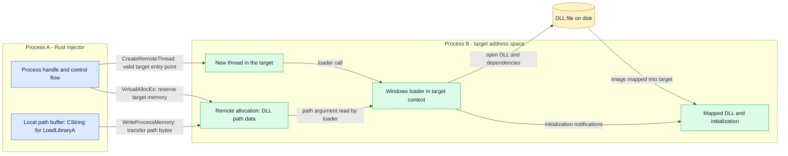
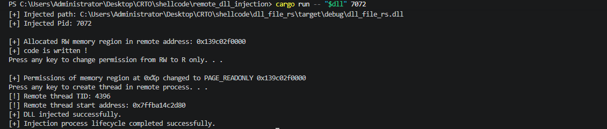
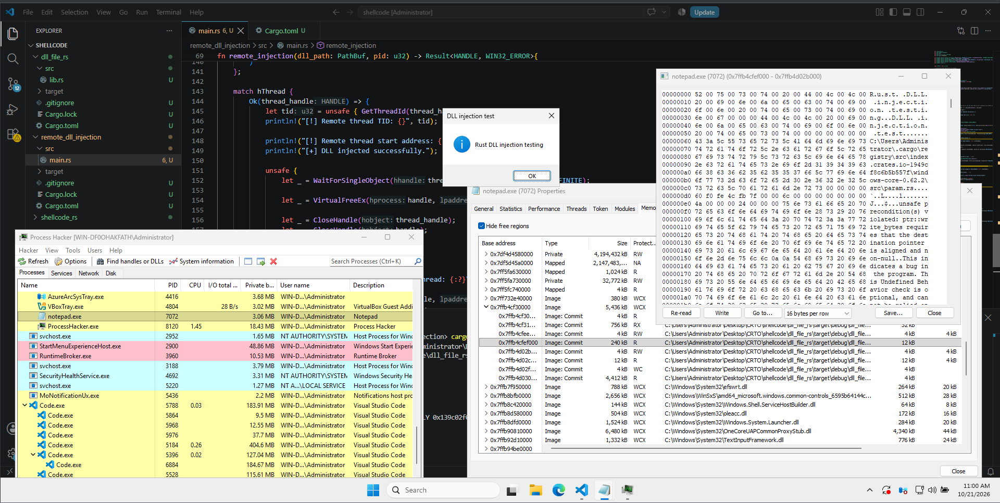

# Remote DLL Injection in Rust

We have already looked at execution inside our own process. This chapter moves the discussion across a process boundary: one process arranges for another process to load a DLL.

The small but important detail is what crosses that boundary. In the loader-based example studied here, it is a **DLL path**. The Windows loader handles the DLL file in the target process. We are not treating a DLL's file contents as a raw shellcode buffer.

**Current example:** the [Rust module](src/main.rs) implements a loader-based DLL injection experiment. The Windows captures below show a run against Notepad, including the DLL's message box and its mapped image in the target's memory view. This is a CRTO study example, with the implementation and observations explained separately.

## Contents

- [What remote means here](#what-remote-means-here)
- [The technical diagram](#the-technical-diagram)
- [The DLL path is the data](#the-dll-path-is-the-data)
- [A handle is not an address](#a-handle-is-not-an-address)
- [Read the workflow as separate responsibilities](#read-the-workflow-as-separate-responsibilities)
- [The recorded Windows run](#the-recorded-windows-run)
- [The path bug and what fixed it](#the-path-bug-and-what-fixed-it)
- [Getting a Windows path right in Rust](#getting-a-windows-path-right-in-rust)
- [The target must be able to load the file](#the-target-must-be-able-to-load-the-file)
- [A function pointer needs a contract](#a-function-pointer-needs-a-contract)
- [Loading is not the same as calling an export](#loading-is-not-the-same-as-calling-an-export)
- [What counts as success?](#what-counts-as-success)
- [Cleanup has an order](#cleanup-has-an-order)
- [Observing the experiment](#observing-the-experiment)
- [Debugging by symptom](#debugging-by-symptom)
- [Connecting this to the repository](#connecting-this-to-the-repository)
- [Primary references](#primary-references)

## What remote means here

Here, “remote” means another process on the same Windows machine. It does not imply a network connection or execution on another computer. `OpenProcess` opens an existing local process object. [Microsoft: OpenProcess](https://learn.microsoft.com/en-us/windows/win32/api/processthreadsapi/nf-processthreadsapi-openprocess)

Keep three roles separate:

| Role | Responsibility |
| --- | --- |
| Injector | The Rust program making the cross-process requests. |
| Target | The process whose address space and threads host the loading behavior. |
| DLL | The module that the target's loader must locate, map, and initialize. |

The executable selecting the target and the DLL being loaded are different artifacts. Compiling either one does not establish that the entire experiment works.

MITRE categorizes DLL injection as **T1055.001**. The loader-based pattern is one form of DLL injection, not a definition covering every possible injection mechanism. [MITRE ATT&CK: DLL Injection](https://attack.mitre.org/techniques/T1055/001/)

## The technical diagram

This maps the loader-based design used by the example. The current source uses a NUL-terminated `CString` and `LoadLibraryA`; the UTF-16 section later in this chapter explains the separate `W` interface.



The DLL stays a file until the loader maps it. The remote path buffer is temporary data; the loaded module is a different memory object with a different lifetime. The [standalone Mermaid source](remote-dll-injection.mmd) is included for reuse.

## The DLL path is the data

In this design, the remote allocation holds something like `C:\lab\example.dll`, encoded for the loader interface being used. It does not hold the DLL's complete PE image.

This explains the memory permissions. The loader needs to read the path. The path buffer itself does not need execute permission. The DLL's executable sections are a separate matter handled during image loading.

Some demonstrations change the path allocation from read/write to read-only after writing it. That can illustrate protection changes, but it is not what causes a DLL to load. `VirtualProtectEx` changes protections on committed pages; it is not an execution trigger or proof of reduced visibility. [Microsoft: VirtualProtectEx](https://learn.microsoft.com/en-us/windows/win32/api/memoryapi/nf-memoryapi-virtualprotectex)

An ordinary local `memcpy` or Rust pointer copy does not acquire cross-process semantics because its destination contains a number observed in another process. The destination address must be interpreted in the correct process context.

## A handle is not an address

Three values can appear in the same log while meaning entirely different things:

| Value | Meaning |
| --- | --- |
| Process identifier | Identifies the process being discussed. |
| Process handle | Provides access to a process object under granted rights. |
| Target virtual address | Identifies a location in that target's address space. |

`OpenProcess` checks the requested access against the process's security descriptor. A handle suitable for one operation is not automatically suitable for every later operation. [Microsoft: OpenProcess](https://learn.microsoft.com/en-us/windows/win32/api/processthreadsapi/nf-processthreadsapi-openprocess)

For example, remote allocation needs `PROCESS_VM_OPERATION`. Writing memory additionally needs `PROCESS_VM_WRITE`. Thread creation has its own documented requirements. Check the operations actually used rather than treating one successful handle-opening call as universal permission.

## Read the workflow as separate responsibilities

| Responsibility | Relevant Windows interface | What its result establishes |
| --- | --- | --- |
| Access | `OpenProcess` | A process handle was obtained with the granted access. |
| Target storage | `VirtualAllocEx` | A region was allocated in the specified process. |
| Data transfer | `WriteProcessMemory` | The requested transfer succeeded; record the byte count as well. |
| Optional protection change | `VirtualProtectEx` | The specified committed pages received new protections. |
| Target execution | `CreateRemoteThread` | A thread was created in the target. |
| Module loading | `LoadLibraryA` / `LoadLibraryW` | In a valid calling context, the loader reports a module handle or failure. |

`VirtualAllocEx` returns an address belonging to the process named by its handle. That address is not a local Rust allocation. [Microsoft: VirtualAllocEx](https://learn.microsoft.com/en-us/windows/win32/api/memoryapi/nf-memoryapi-virtualallocex)

`WriteProcessMemory` distinguishes the caller's source buffer from the target's destination address. Its size is measured in bytes, and the entire requested destination range must be writable. Recording the reported transfer size makes the observation more useful than a generic “write succeeded” line. [Microsoft: WriteProcessMemory](https://learn.microsoft.com/en-us/windows/win32/api/memoryapi/nf-memoryapi-writeprocessmemory)

A successful thread-creation call does not establish that its start address is valid or that the thread completed its intended work. Windows documents that an invalid start address can fail when the thread runs. [Microsoft: CreateRemoteThread](https://learn.microsoft.com/en-us/windows/win32/api/processthreadsapi/nf-processthreadsapi-createremotethread)

## The recorded Windows run

The experiment targeted **Notepad, PID 7072**. The terminal capture records a path write, a change from read/write to read-only, and creation of remote thread **4396**. Those identifiers describe this run; they are not configuration values for another machine.



The second capture provides the useful visual context: Notepad is selected in Process Hacker, its memory view contains image-backed regions associated with the lab DLL path, and the message box displays **Rust DLL injection testing**.



Together with the reported lab result, these captures support that the DLL loaded and produced the intended visible effect. The terminal's “DLL injected successfully” line alone would not establish that outcome.

### Matching the source to the observation

The [current source](src/main.rs) reads two positional arguments: the DLL path first, then the target PID. Although `Args` derives `clap::Parser`, an inherent `Args::parse` method reads `std::env::args` directly. The commands here follow that actual positional interface.

The path becomes a `CString`; its NUL-terminated bytes are the data written to the target. The example then changes that region to `PAGE_READONLY`, resolves `LoadLibraryA` locally, and uses the resulting value in its remote-thread request. The address and callback assumptions discussed below still apply.

Two details matter when reading the capture. The “Press any key” messages are currently printed labels; the source does not perform an input read there. The function also prints success before checking the loading outcome and returns `Ok(handle)` after its later branches, including some failure paths. These screenshots document the working path, not a complete validation of error handling.

## The path bug and what fixed it

The first attempt passed a relative path:

```text
..\dll_file_rs\target\debug\dll_file_rs.dll
```

The remote thread was created, but the expected message box did not appear. The injector could interpret that path from its project directory; that did not establish that the target loader would find the same DLL through its own path-resolution context.

The working retry resolved the file in PowerShell first and passed its full path. From the Windows injector project directory:

```powershell
$dll = (Resolve-Path '..\dll_file_rs\target\debug\dll_file_rs.dll' -ErrorAction Stop).Path
cargo run -- "$dll" 7072
```

`-ErrorAction Stop` makes path-resolution failures terminating errors. Resolve the file successfully before running Cargo. Quotes preserve a path containing spaces. The DLL project in the Windows capture is named `dll_file_rs`; the repository's DLL source lives under `dll_gen`. Use the path of the file actually built in your own lab, and select the current PID of the target you control.

The successful run followed this path change. No new injection mechanism was needed: the target needed a file path it could resolve. A full path identifies the primary DLL; its dependencies and initialization still need to succeed. [Microsoft: LoadLibraryA](https://learn.microsoft.com/en-us/windows/win32/api/libloaderapi/nf-libloaderapi-loadlibrarya)

## Getting a Windows path right in Rust

The current demo uses `LoadLibraryA` and an ASCII lab path. Its `to_string_lossy`/`CString` conversion is not a general solution for every Windows filename. The `A` and `W` Windows interfaces expect different string representations. A Rust `String` is UTF-8; passing its bytes does not turn them into the wide string expected by `LoadLibraryW`.

For a known Unicode string, this standalone example demonstrates UTF-16 encoding and byte-count accounting. It does not open or modify another process:

```rust
use std::mem::size_of;

fn encode_path(path: &str) -> Result<Vec<u16>, &'static str> {
    if path.is_empty() || path.contains('\0') {
        return Err("the DLL path must be nonempty and contain no NUL characters");
    }

    let mut wide: Vec<u16> = path.encode_utf16().collect();
    wide.push(0);
    Ok(wide)
}

fn main() {
    let wide = encode_path(r"C:\lab\example.dll").expect("valid example path");
    let byte_count = wide.len()
        .checked_mul(size_of::<u16>())
        .expect("path byte count fits in usize");

    assert_eq!(wide.last(), Some(&0));
    assert_eq!(byte_count, 38); // 18 UTF-16 code units, plus NUL, at two bytes each.
}
```

`encode_utf16` yields code units, not a NUL-terminated Windows string. The example appends the terminator and includes it in the byte count. For non-ASCII text, counting characters, UTF-8 bytes, and UTF-16 units can produce different results. [Rust: str::encode_utf16](https://doc.rust-lang.org/std/primitive.str.html#method.encode_utf16)

For actual Windows filesystem paths obtained as `Path`/`OsStr`, the Windows-specific `OsStrExt::encode_wide` preserves the OS path representation, including values that are not ordinary Unicode strings. It also does not append a terminator automatically. [Rust: OsStrExt](https://doc.rust-lang.org/std/os/windows/ffi/trait.OsStrExt.html)

Keep the local encoded buffer alive while an API reads it. Separately track the remote buffer's lifetime while the target may still read that copy. A cast to a Windows pointer wrapper does not transfer data, extend either lifetime, or create a valid Rust reference to remote memory.

## The target must be able to load the file

The path is interpreted by the loader running in the target process. A full path removes ambiguity about the requested DLL file; a relative path depends on search behavior. The target also needs access to the file and the dependencies required to load it. [Microsoft: LoadLibraryW](https://learn.microsoft.com/en-us/windows/win32/api/libloaderapi/nf-libloaderapi-loadlibraryw)

For this lab, keep the architecture straightforward: an x64 injector, an x64 target, and an x64 DLL. A 64-bit process cannot load a 32-bit DLL, and a 32-bit process cannot load a 64-bit DLL. Being on a 64-bit Windows installation does not make every running process 64-bit. [Microsoft: Process Interoperability](https://learn.microsoft.com/en-us/windows/win32/winprog64/process-interoperability)

When a DLL fails to load, the primary file can be present while one of its dependencies is missing. “The path exists” is a useful check, not the whole diagnosis.

## A function pointer needs a contract

There are two independent requirements: the address must be valid in the target, and the function must be invoked under a compatible ABI.

Resolving a loader function in the injector does not, by itself, prove that the same numeric address is valid in the target. Avoid building an explanation around identical addresses observed in one lab run. `CreateRemoteThread` specifically requires a start function that exists in the remote process. [Microsoft: CreateRemoteThread](https://learn.microsoft.com/en-us/windows/win32/api/processthreadsapi/nf-processthreadsapi-createremotethread)

Common demonstrations cast a `LoadLibrary` address to a thread-start callback type. That is a shortcut with assumptions, not a general conversion guarantee. `LoadLibraryW` returns `HMODULE`, while the Windows thread callback returns a `DWORD`. Declaring or transmuting a pointer as a different function type does not reconcile those signatures.

On Windows x64, `DWORD` remains 32 bits while pointer-sized values are 64 bits. Keep that distinction visible when interpreting results. [Microsoft: Windows Data Types](https://learn.microsoft.com/en-us/windows/win32/winprog/windows-data-types)

## Loading is not the same as calling an export

A DLL can expose functions without the loader automatically invoking all of them. Our [DLL prototype](../dll_gen/src/lib.rs) has an exported `show_msg` function and calls it from `DllMain`. Those are separate roles: an export defines an available interface; initialization determines what happens during loading.

`DllMain` receives a reason describing process or thread attachment/detachment. An unconditional call in that callback can therefore behave differently from a function intended to run once per experiment. [Microsoft: DllMain](https://learn.microsoft.com/en-us/windows/win32/dlls/dllmain)

There is another catch: `DllMain` runs under the loader lock. UI calls, further module loading, or synchronization there can make an experiment hang or fail during initialization. A message box inside `DllMain` is a demonstration shortcut with real limitations. Microsoft recommends minimal initialization and deferring substantial work until after loading. [Microsoft: DLL Best Practices](https://learn.microsoft.com/en-us/windows/win32/dlls/dynamic-link-library-best-practices)

For the Rust export syntax itself, see the existing [no_mangle guide](../shellcode_dll_generation/docs/no-mangle.md). A correctly named symbol and a correctly initialized module answer different questions.

## What counts as success?

The phrase “DLL injected successfully” is doing too much work if it is printed immediately after thread creation.

| Observation | What it supports | What remains unproven |
| --- | --- | --- |
| A process handle was obtained | Access to that process object was granted. | Allocation, loading, and execution. |
| The target buffer contains the full path | Data reached the expected address space. | Whether the loader can open the file. |
| A remote thread was created | Thread creation succeeded. | Correct entry, module loading, and initialization. |
| The thread terminated | The thread stopped running. | Whether it completed the intended operation successfully. |
| The expected DLL appears in the target's module view | That module is present at inspection time. | Whether this particular experiment caused the load, if it was already present. |
| A visible effect appears | Some observable behavior occurred. | Its complete causal chain without supporting evidence. |

`GetExitCodeThread` reports a termination status through a `DWORD`. It is not a general-purpose way to retrieve a complete 64-bit module handle. Correlate status information with module and execution evidence rather than treating a nonzero value as a complete proof of loading. [Microsoft: GetExitCodeThread](https://learn.microsoft.com/en-us/windows/win32/api/processthreadsapi/nf-processthreadsapi-getexitcodethread)

## Cleanup has an order

The local path buffer, target path allocation, thread handle, process handle, and loaded DLL are distinct resources. Their lifetimes should be explained individually.

| Resource | Lifetime consideration |
| --- | --- |
| Local path buffer | Must remain valid while the copying API reads it, whether it contains ANSI-interface bytes or UTF-16 code units. |
| Remote path allocation | Must remain valid while the target may still read the argument. |
| Thread handle | Used to observe/manage that thread object; closing it does not terminate the thread. |
| Process handle | Needed for the target-memory operations still outstanding. |
| Loaded module | Has loader-managed state independent of the temporary path allocation. |

Releasing the path buffer does not unload the DLL. Closing a handle does not mean the corresponding operation completed. On a failed or timed-out wait, do not assume the target has finished reading the argument.

`VirtualFreeEx` releases memory in the process specified by its handle. With `MEM_RELEASE`, it requires the original allocation base and a size of zero. Do not substitute the injector's local buffer address. [Microsoft: VirtualFreeEx](https://learn.microsoft.com/en-us/windows/win32/api/memoryapi/nf-memoryapi-virtualfreeex)

## Observing the experiment

Capture enough context to explain the run: injector and target identities, architectures, DLL path, operation results, and timestamps. A memory inspection can show the path bytes; a module view can show the loaded image. They are different observations.

Configured Sysmon telemetry can add context:

| Event | Relevant observation |
| --- | --- |
| 1 — Process creation | Process identity and creation context. |
| 7 — Image loaded | Module loading in a process, when enabled. |
| 8 — CreateRemoteThread | Source/target thread-creation activity and start-address metadata. |
| 10 — ProcessAccess | A process opening another process. |

These events depend on collection configuration and filtering. Process access is not itself a memory-write record, and a loader-like start address is not enough to classify activity as malicious. Correlate the events and the lab's known actions. [Microsoft: Sysmon](https://learn.microsoft.com/en-us/sysinternals/downloads/sysmon)

## Debugging by symptom

| Symptom | Useful investigation |
| --- | --- |
| Access denied | Requested rights, target restrictions, and the caller's security context. |
| Unexpected characters in the remote dump | Encoding, NUL termination, transfer length, and whether the view is displaying bytes or wide text. |
| Thread creation succeeds, then the target crashes | Target-valid start address, callback contract, path pointer, and captured exception details. |
| The DLL file exists but does not load | Target/DLL architecture, dependencies, target access to the file, and initialization failure. |
| The operation appears to hang | Loader-lock behavior, blocking initialization, and actual wait status. |
| The same effect appears multiple times | Initialization reasons, repeated loads, and whether the DLL was already present. |

Change one assumption at a time and record what the observation actually establishes. Otherwise, a working run can be just as hard to explain as a broken one.

## Connecting this to the repository

- [Remote module source](src/main.rs) and [manifest](Cargo.toml): the implementation accompanying the recorded Windows run.
- [DLL prototype](../dll_gen/src/lib.rs): the module being studied separately from the injector.
- [Shellcode and DLL foundations](../shellcode_dll_generation/README.md): local execution, representations, and initialization basics.
- [Export naming in Rust](../shellcode_dll_generation/docs/no-mangle.md): `#[unsafe(no_mangle)]`, ABIs, and library inspection.

The captures document this Windows lab run. Dependency resolution from a clean checkout, other target architectures, and failure paths have not been independently verified here.

## Primary references

- [MITRE ATT&CK: Dynamic-link Library Injection](https://attack.mitre.org/techniques/T1055/001/).
- [Microsoft: OpenProcess](https://learn.microsoft.com/en-us/windows/win32/api/processthreadsapi/nf-processthreadsapi-openprocess), [VirtualAllocEx](https://learn.microsoft.com/en-us/windows/win32/api/memoryapi/nf-memoryapi-virtualallocex), and [WriteProcessMemory](https://learn.microsoft.com/en-us/windows/win32/api/memoryapi/nf-memoryapi-writeprocessmemory).
- [Microsoft: CreateRemoteThread](https://learn.microsoft.com/en-us/windows/win32/api/processthreadsapi/nf-processthreadsapi-createremotethread), [LoadLibraryW](https://learn.microsoft.com/en-us/windows/win32/api/libloaderapi/nf-libloaderapi-loadlibraryw), and [GetExitCodeThread](https://learn.microsoft.com/en-us/windows/win32/api/processthreadsapi/nf-processthreadsapi-getexitcodethread).
- [Microsoft: DllMain](https://learn.microsoft.com/en-us/windows/win32/dlls/dllmain) and [DLL Best Practices](https://learn.microsoft.com/en-us/windows/win32/dlls/dynamic-link-library-best-practices).
- [Rust: Windows OsStrExt](https://doc.rust-lang.org/std/os/windows/ffi/trait.OsStrExt.html).
