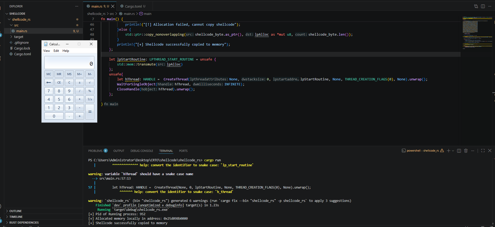

# Shellcode and DLLs: Foundations for Injection in Rust

Before studying injection techniques, we need to understand what is being placed into memory. A raw machine-code buffer, a DLL file, and the executable that hosts them have different structures and execution requirements.

This chapter develops those foundations using the calculator and message-box examples from the **Compiling Shellcode and DLL** lesson. The explanations are written independently, with Windows and Rust documentation used to check the details. The aim is to make the reasoning useful to anyone following this study repository.

**Current state:** [shellcode_rs](shellcode_rs/) contains a Rust local shellcode execution example. Its [source](shellcode_rs/src/main.rs), [Cargo manifest](shellcode_rs/Cargo.toml), and [Windows execution screenshot](shellcode.png) are available in this directory. A separate [exports example](no_mangle_examples/) demonstrates a Rust library interface. Remote DLL injection and the lesson's message-box DLL have not been implemented here.

## Contents

- [Shellcode, DLL, and host executable](#shellcode-dll-and-host-executable)
- [What makes shellcode executable?](#what-makes-shellcode-executable)
- [Bytes, text, and lengths in Rust](#bytes-text-and-lengths-in-rust)
- [Understanding the local execution example](#understanding-the-local-execution-example)
- [The Rust implementation](#the-rust-implementation)
- [Execution demo](#execution-demo)
- [How a DLL differs](#how-a-dll-differs)
- [DLL initialization and loader lock](#dll-initialization-and-loader-lock)
- [Building a DLL with Rust](#building-a-dll-with-rust)
- [Understanding binary size](#understanding-binary-size)
- [What the examples demonstrate](#what-the-examples-demonstrate)
- [Further reading](#further-reading)

## Shellcode, DLL, and host executable

| Artifact | What it contains | What must happen before its intended behavior occurs |
| --- | --- | --- |
| Shellcode buffer | Machine-code bytes and any embedded data required by that sample. | A compatible execution environment must provide usable memory and an appropriate execution path. |
| DLL | A Windows Portable Executable (PE) image, including headers, sections, and loading metadata. | A loader must interpret the image and perform the relevant initialization. |
| Host executable | The application responsible for the experiment. | Windows loads the executable, which then performs the behavior being studied. |

A DLL is not a raw shellcode buffer with a different extension. PE metadata describes how an image should be laid out and connected to its dependencies. Copying file contents into an arbitrary buffer does not automatically perform that work. [Microsoft: PE Format](https://learn.microsoft.com/en-us/windows/win32/debug/pe-format)

Generating a sample, compiling its host, loading a module, and executing code are separate events. Keeping them separate makes failures easier to explain.

## What makes shellcode executable?

Shellcode is machine code intended to execute in a particular environment. The name does not require it to open a command shell: the lesson's example launches Calculator to provide a visible result.

Many shellcode samples are designed to be position independent, meaning they can operate without a single predetermined load address. That property comes from their design. An arbitrary compiled function or executable does not become position independent simply because its bytes are extracted.

Before interpreting a sample, establish:

- **Platform and architecture:** Windows x64 bytes require a compatible execution context.
- **Dependencies:** code can still depend on operating system functions, embedded data, or assumptions about its surroundings.
- **Entry and exit behavior:** identify how execution begins and whether the sample returns, ends a thread, or terminates a process.
- **Memory requirements:** readable, writable, and executable describe different properties.

The lesson uses a generated Calculator sample and displays it as a C byte array. That output format is a representation of the bytes; it does not determine which language must host them.

The sample also uses encoding. Encoding changes the stored representation and can introduce a decoding stage. It does not establish correctness, compatibility, or an ability to avoid detection. Treat those as separate questions requiring evidence.

## Bytes, text, and lengths in Rust

For this work, a byte slice such as `&[u8]` expresses binary data directly. A `String` expresses UTF-8 text, which is a different abstraction.

This small example illustrates representation only; these are arbitrary data bytes, not an executable sample:

```rust
fn main() {
    let bytes: &[u8] = &[0x41, 0x00, 0xFF, 0x42];
    let escaped_bytes: &[u8] = b"\x41\x00\xFF\x42";
    let printed_escape = r"\x41";

    assert_eq!(bytes, escaped_bytes);
    assert_eq!(bytes.len(), 4);
    assert_eq!(printed_escape.len(), 4); // Four text characters, not one byte.
}
```

Rust byte strings accept byte escapes and do not add a trailing NUL terminator. A raw string such as `r"\x41"` preserves the backslash and characters literally. [The Rust Reference: Byte String Literals](https://doc.rust-lang.org/reference/tokens.html#byte-string-literals)

The [Rust implementation](shellcode_rs/src/main.rs) declares `shellcode_bytes` as `&[u8; 319]`. The byte string contains **319 explicit byte escapes**, with no additional terminator supplied by the language. The fixed array length lets the compiler check that the initializer contains the declared number of bytes.

This differs from an inferred C array initialized with a string literal, which also includes an implicit trailing NUL. When translating examples, distinguish that source-language terminator from the sample's explicitly specified bytes.

For a Rust byte slice, `.len()` gives the element count, which is also the byte count for `u8`. A pointer's size and a slice reference's size describe those values, not the length of the pointed-to buffer. Keep the bytes and their intended length together.

## Understanding the local execution example

The lesson allocates memory in the calling process and creates a thread in that same process. This demonstrates **local execution**, often called self injection in study material. It does not demonstrate crossing into another process.

The useful exercise is to understand each responsibility without treating the API names as proof that execution succeeded:

| Responsibility | Meaning in the lesson | Question to answer |
| --- | --- | --- |
| Memory ownership | `VirtualAlloc` operates in the caller's address space. | Which process owns the resulting address? |
| Byte placement | `RtlMoveMemory` copies a specified number of bytes. | Are the source, destination, and length valid? |
| Execution | `CreateThread` creates a thread in the calling process. | Does the start address actually satisfy the execution contract? |
| Synchronization | A wait observes the thread object's state. | Did the wait complete successfully, and what does that establish? |
| Cleanup | Allocations and handles have lifetimes. | Can every resource be released correctly after it is no longer in use? |

### Allocation and protection

`VirtualAlloc` concerns both reservation/commit state and page protections. Allocating memory is not the same as demonstrating that the contents are valid instructions. Microsoft's documentation also assigns responsibility for instruction-cache coherency when preparing dynamically generated code for execution. [Microsoft: VirtualAlloc](https://learn.microsoft.com/en-us/windows/win32/api/memoryapi/nf-memoryapi-virtualalloc)

The lesson uses memory that is writable and executable at the same time. That is a property of its example, not a universal requirement for every implementation. When reading Rust code, explain the chosen protections and lifetime rather than assuming the lesson's flags are mandatory.

### Copying does not return a success flag here

The lesson includes a conditional check around `RtlMoveMemory`. Its documented return type is `void`; it does not supply a Boolean success result. That conditional should not be translated literally into Rust. Valid memory ranges and the requested length must be established by the caller. [Microsoft: RtlMoveMemory](https://learn.microsoft.com/en-us/windows-hardware/drivers/ddi/wdm/nf-wdm-rtlmovememory)

### A pointer cast does not validate an entry point

The lesson casts a memory address to a thread-start function pointer. Changing its type does not prove that the code follows the required calling convention, uses a valid stack, or has compatible return behavior. `CreateThread` can return successfully even when the start address later causes an execution failure. [Microsoft: CreateThread](https://learn.microsoft.com/en-us/windows/win32/api/processthreadsapi/nf-processthreadsapi-createthread)

Rust makes this an important `unsafe` boundary. The Rust implementation below expresses this conversion with `transmute`; its role and limits are explained separately from byte copying.

### A completed wait is narrower evidence than a completed objective

A thread object becoming signaled means the thread has terminated. It does not independently prove that Calculator opened or that the intended work completed. Check the wait result and corroborate the outcome with observations. [Microsoft: WaitForSingleObject](https://learn.microsoft.com/en-us/windows/win32/api/synchapi/nf-synchapi-waitforsingleobject)

## The Rust implementation

The [main program](shellcode_rs/src/main.rs) applies the local execution model using Rust and Microsoft's Windows bindings. It operates within its own process. The source does not open another process or load a DLL.

### Project layout

```text
shellcode_dll_generation/
├── README.md
├── shellcode.png
└── shellcode_rs/
    ├── Cargo.toml
    ├── Cargo.lock
    └── src/
        └── main.rs
```

The [manifest](shellcode_rs/Cargo.toml) identifies the package as `shellcode_rs`, uses Rust edition `2024`, and declares the `windows` dependency with the version requirement `0.62.2`. [Cargo.lock](shellcode_rs/Cargo.lock) records the resolved dependency versions. The enabled features cover Foundation, Memory, Threading, and Security. The source requires a Windows x64 target.

### Reading the program

| Part of the source | What it does in this example |
| --- | --- |
| `shellcode_bytes: &[u8; 319]` | Holds the embedded bytes. `.len()` supplies the buffer length used by the allocation and copy. |
| `GetCurrentProcessId` | Obtains the current process identifier for the diagnostic output. |
| `VirtualAlloc` | Reserves and commits local memory with `MEM_RESERVE \| MEM_COMMIT` and `PAGE_EXECUTE_READWRITE`. A null result ends the attempt before copying or creating a thread. |
| `copy_nonoverlapping` | On the non-null allocation branch, copies the bytes into that local allocation. |
| `transmute` | Reinterprets the allocation pointer as `LPTHREAD_START_ROUTINE`, the Windows binding's thread-start callback type. |
| `CreateThread` | Requests a thread in the calling process using that callback value. Failure is reported with context, and the unused allocation is released. |
| `WaitForSingleObject` | Waits on the thread handle using `INFINITE` and checks for `WAIT_OBJECT_0`. Other results produce an error. |
| `CloseHandle` | Closes the thread handle after the wait returns, reporting a cleanup failure if one occurs. |
| `VirtualFree` | Releases the allocation after confirmed thread termination, or if thread creation failed. It uses the original allocation base and a zero size with `MEM_RELEASE`. |

### What the Rust types explain

The embedded byte array and the allocated region are separate storage locations. `shellcode_bytes.as_ptr()` identifies the original bytes, while `allocation` identifies the destination returned by Windows.

`copy_nonoverlapping` copies a count of elements of its inferred type. Here both sides are treated as `u8`, so a count of 319 means 319 bytes. The caller is responsible for valid source and destination ranges, alignment, and non-overlap. The function copies data; it does not start executing it. [Rust: copy_nonoverlapping](https://doc.rust-lang.org/std/ptr/fn.copy_nonoverlapping.html)

The subsequent `transmute` changes the interpretation of a pointer value. It does not copy the buffer again or verify that its contents satisfy the callback's execution contract. A type conversion and a valid callable entry point are separate concerns. [Rust: transmute](https://doc.rust-lang.org/std/mem/fn.transmute.html)

These operations explain why Rust ownership of the original byte array does not automatically cover the Windows allocation, and why successful compilation alone cannot establish runtime correctness.

### Error handling and cleanup

The program reports named operation failures and returns a nonzero exit status instead of unwrapping Windows API errors. The copy-success message is emitted only after the bytes have been copied. After confirmed thread termination, both handle cleanup and memory release are attempted, and cleanup errors are reported together if necessary.

If the wait fails or returns an unexpected status, thread completion is unconfirmed. The program closes its handle but leaves the allocation for process teardown rather than release code a thread may still be using. With `MEM_RELEASE`, `VirtualFree` requires the original allocation base and a size of zero. [Microsoft: VirtualFree](https://learn.microsoft.com/en-us/windows/win32/api/memoryapi/nf-memoryapi-virtualfree)

## Execution demo

The supplied Windows lab screenshot shows the initial Rust version in VS Code, a `cargo run` invocation, and a visible Calculator window. The current source has since received error-handling, cleanup, and formatting changes; this capture is not a test result for those changes:



### What the capture records

- Cargo reports that the development build finished and runs `target\debug\shellcode_rs.exe`.
- The build reports **six compiler warnings**; the visible diagnostics include naming-style warnings.
- The program prints its process identifier, an allocated local address, and its copy-status message.
- Calculator is visible alongside the source and terminal output.

This is the recorded lab demonstration for the example. Process identifiers and allocation addresses belong to that run and are not fixed values to reproduce. The copy-status line is application output rather than an independent check of memory contents. The capture does not show the wait result, the thread's exit status, or a process trace establishing the full execution chain.

### Running the existing project

The embedded sample is intended for Windows x64. Use a Windows x64 Rust toolchain and its required linker/build tools. From `shellcode_dll_generation`, the project can be invoked with:

```powershell
cargo run --locked --manifest-path shellcode_rs/Cargo.toml
```

Alternatively, run `cargo run --locked` from inside `shellcode_rs`. The screenshot used `cargo run` before the lockfile was added. These commands run the current local execution example; they do not build a DLL or demonstrate injection into another process. The screenshot records a development build, so it is not a release-size measurement.

## How a DLL differs

A DLL is a module loaded into a process. Under ordinary Windows loading, the loader interprets the image and its dependencies before the application can use the module's functionality.

`LoadLibraryW` loads a module into the **calling process**. Calling it locally is ordinary dynamic loading. DLL injection involves causing a different process to host the module; compiling a DLL or loading it locally does not establish that remote step. [Microsoft: LoadLibraryW](https://learn.microsoft.com/en-us/windows/win32/api/libloaderapi/nf-libloaderapi-loadlibraryw)

This distinction separates three things we will study:

1. **The module:** what the DLL contains and exposes.
2. **The loading behavior:** how it becomes usable in a process.
3. **The process boundary:** whether that process is the caller or another process.

The message-box example in the lesson makes module initialization visible. It is an illustration of behavior on loading, not evidence that every DLL needs a graphical interface or that a remote injection has occurred.

## DLL initialization and loader lock

`DllMain` is a DLL initialization callback, not the DLL equivalent of an application's ordinary `main` function. Its reason parameter identifies the notification being delivered:

| Notification | General meaning |
| --- | --- |
| `DLL_PROCESS_ATTACH` | The DLL is being attached to a process. |
| `DLL_PROCESS_DETACH` | The DLL is being detached; the shutdown context matters. |
| `DLL_THREAD_ATTACH` | A thread-creation notification, where applicable. |
| `DLL_THREAD_DETACH` | A thread-exit notification, where applicable. |

Thread notifications are not a guaranteed per-thread accounting mechanism in every loading or termination scenario. Consult the documented exceptions before depending on them. [Microsoft: DllMain](https://learn.microsoft.com/en-us/windows/win32/dlls/dllmain)

Windows calls `DllMain` while holding the loader lock. Work performed there can interact with other module loading and synchronization, creating deadlocks or initialization failures. Keep initialization minimal and place substantial work in an explicit initialization or exported function invoked after loading. The same restrictions apply to Rust code reached from that callback. [Microsoft: DLL Best Practices](https://learn.microsoft.com/en-us/windows/win32/dlls/dynamic-link-library-best-practices)

In particular, the lesson's message box inside `DllMain` is a teaching shortcut. Microsoft advises against User32/GDI calls in this context because they can involve additional loading. A reusable example should demonstrate its visible behavior after initialization rather than adopt that shortcut as a design pattern.

## Building a DLL with Rust

For a focused explanation of exported names, ABIs, and edition-2024 syntax, see [Understanding `#[no_mangle]` and `#[unsafe(no_mangle)]`](docs/no-mangle.md). Its [standalone example](no_mangle_examples/) builds a small library with named functions and read-only metadata; it is separate from the shellcode execution project.

For a Rust library intended to be consumed through a system-compatible interface, `cdylib` is the relevant crate type. On a Windows target, it produces a DLL. A Rust `dylib` serves Rust dynamic-linking use cases and is a different artifact choice. [The Rust Reference: Linkage](https://doc.rust-lang.org/reference/linkage.html)

The following is a configuration fragment for a future DLL crate, not a claim that a buildable crate already exists in this folder:

```toml
[lib]
crate-type = ["cdylib"]
```

Selecting a crate type does not define the DLL's public interface or prove its initialization behavior. The eventual Rust example needs to document its Windows target, exported interface, ABI, ownership rules, and how a test host observes the result.

Building Rust for Windows produces a Windows artifact; it does not automatically produce a standalone shellcode blob. The PE structure, runtime dependencies, and loading assumptions still exist.

## Understanding binary size

The size of the byte buffer, the host executable, and the DLL are separate measurements. A small byte array can live inside a much larger executable because the latter also contains code, metadata, dependencies, and possibly debugging information.

The lesson compares builds made with different GCC options. Its numerical results belong to that toolchain and example; they are not expected Rust output sizes. Warning suppression is also separate from optimization and does not repair the behavior being warned about.

For Rust, Cargo profiles expose choices such as size-oriented optimization, link-time optimization, and symbol stripping. Their effects depend on the program, dependencies, and linker. Keep useful diagnostics while developing, then compare equivalent builds before drawing conclusions about size. Some smaller-build settings can increase build time or change debugging and runtime tradeoffs. [The Cargo Book: Profiles](https://doc.rust-lang.org/cargo/reference/profiles.html)

Record which artifact was measured, the build target/profile, and the unit used. A smaller executable is a size result; it does not establish correct execution or reduced visibility to monitoring.

## What the examples demonstrate

| Observation | Supported conclusion | What still needs separate evidence |
| --- | --- | --- |
| A byte array is present in source. | The source contains a representation of bytes. | Their behavior and compatibility when executed. |
| A host program compiles. | The source and selected build configuration produced an artifact. | Correct memory handling and runtime behavior. |
| A local thread starts successfully. | The thread-creation operation succeeded. | The thread's eventual behavior and outcome. |
| Calculator appears. | A visible effect occurred in that experiment. | Which process and execution path caused it. |
| A DLL loads in a test host. | That host could load that module in that environment. | Remote loading, exported-function behavior, and cleanup. |

The Rust source and screenshot now provide a concrete local example to read against these concepts. Its recorded observations are distinct from the lesson's message-box DLL illustration, for which this directory does not yet contain an implementation or execution capture.

## Further reading

- **Lesson context:** Hack The Box Academy, *Process Injection Attacks and Detection*, “Compiling Shellcode and DLL.” The calculator and message-box examples are the starting point for this chapter; no payload listing or C implementation is reproduced here. [Original module](https://academy.hackthebox.com/app/module/266)
- **Image structure:** [Microsoft PE Format](https://learn.microsoft.com/en-us/windows/win32/debug/pe-format).
- **Loading behavior:** [LoadLibraryW](https://learn.microsoft.com/en-us/windows/win32/api/libloaderapi/nf-libloaderapi-loadlibraryw), [DllMain](https://learn.microsoft.com/en-us/windows/win32/dlls/dllmain), and [DLL Best Practices](https://learn.microsoft.com/en-us/windows/win32/dlls/dynamic-link-library-best-practices).
- **Rust representations and artifacts:** [Byte String Literals](https://doc.rust-lang.org/reference/tokens.html#byte-string-literals), [Linkage](https://doc.rust-lang.org/reference/linkage.html), and [Cargo Profiles](https://doc.rust-lang.org/cargo/reference/profiles.html).

[Return to the repository overview](../README.md)
