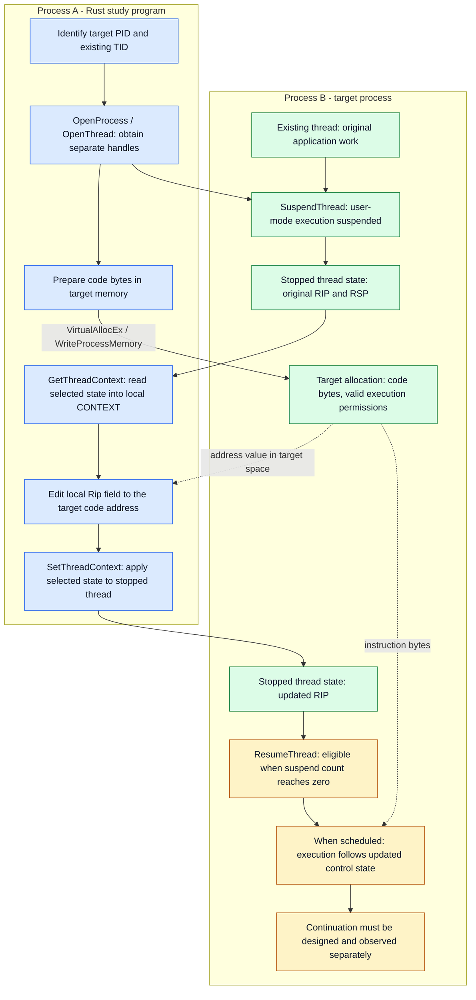

# Thread Execution Hijacking in Rust

Our remote DLL chapter used a new thread to ask the target's loader to load a file. This chapter changes the execution mechanism: **redirect a thread that already exists inside the target process**.

The interesting part is not just getting different code to run. That thread already has work, register values, a stack, and a place where it expects to continue. Borrowing its execution does not make those responsibilities disappear.

**Scope:** Windows x64 theory and Rust implementation considerations for CRTO study. The [Rust module](../../thread_execution_hijacking/src/main.rs) now performs the study sequence against a lab-owned Notepad target: process lookup, remote allocation and write, selection of an existing thread, context redirection, and resumption. The two supplied captures record a visible MessageBox result and stack inspection. They do not prove that every failure path, continuation case, or target architecture has been validated.

## Contents

- [What changes from remote DLL injection?](#what-changes-from-remote-dll-injection)
- [The current Rust module and recorded lab runs](#the-current-rust-module-and-recorded-lab-runs)
- [When the target disappeared](#when-the-target-disappeared)
- [Execution diagram](#execution-diagram)
- [RIP: the instruction address](#rip-the-instruction-address)
- [CONTEXT: a selected view of thread state](#context-a-selected-view-of-thread-state)
- [The assignment in the supplied diagram](#the-assignment-in-the-supplied-diagram)
- [Local edit, context update, execution](#local-edit-context-update-execution)
- [A small Rust model](#a-small-rust-model)
- [Process access and thread access](#process-access-and-thread-access)
- [Finding a thread does not make it the main thread](#finding-a-thread-does-not-make-it-the-main-thread)
- [Suspension is counted](#suspension-is-counted)
- [Memory permissions and instruction bytes](#memory-permissions-and-instruction-bytes)
- [The stack still belongs to the interrupted work](#the-stack-still-belongs-to-the-interrupted-work)
- [Rust details that deserve attention](#rust-details-that-deserve-attention)
- [Debugging by observation](#debugging-by-observation)
- [Cleanup depends on execution state](#cleanup-depends-on-execution-state)
- [Detection and visibility](#detection-and-visibility)
- [Check your understanding](#check-your-understanding)
- [Continue through the repository](#continue-through-the-repository)
- [Primary references](#primary-references)

## What changes from remote DLL injection?

In the previous example, the remote buffer contained a **DLL path**. A newly created target thread entered a loader function, which read that path as data.

In the direct instruction-pointer redirection discussed here, the destination contains **instructions**. An existing target thread is made to continue at that address. Pointing RIP at a path string would ask the processor to decode the string's bytes as instructions; it would not load the named DLL.

| Question | Previous loader-based DLL example | Thread execution hijacking studied here |
| --- | --- | --- |
| What carries execution? | A newly created remote thread. | A thread already present in the target. |
| What is in the remote buffer? | A NUL-terminated DLL path. | Code bytes and any data needed by that code. |
| What controls entry? | A thread-start request with a loader entry point. | A change to the existing thread's saved control state. |
| What needs separate consideration? | Loading, initialization, and thread completion. | Entry, interrupted state, continuation, and target health. |

MITRE ATT&CK identifies thread execution hijacking as **T1055.003**. The essential idea is changing an existing thread's execution flow. Replacing the process image is not required for the mechanism described in this chapter. [MITRE: Thread Execution Hijacking](https://attack.mitre.org/techniques/T1055/003/)

## The current Rust module and recorded lab runs

The current [source](../../thread_execution_hijacking/src/main.rs) is a Rust implementation of the study sequence. It accepts a process name through Clap, enumerates processes and threads, allocates a 349-byte buffer in the target, writes the byte array, finds one thread owned by the target PID, then uses `CONTEXT_FULL_AMD64`, `GetThreadContext`, `context.Rip = remote_buffer as u64`, `SetThreadContext`, and `ResumeThread`.

The terminal capture records a complete run against Notepad: allocation, a write beginning `FC 48 81`, selection of TID 1572, thread suspension, a context update, and resumption.


The second capture supplies the stronger execution evidence. Notepad remains present in Process Hacker, the selected target thread is shown in a MessageBox-related stack, and the message box displays the lab text `TEH` under the title `rust thread execution hijacking`.


The screenshots show two different moments, with different PIDs and TIDs. Treat those numbers as lab observations, not configuration values: the target must be identified again each time it runs.

### What the implementation currently establishes

| Observation in the source or captures | What it supports | What it does not establish |
| --- | --- | --- |
| `WriteProcessMemory` returns success | The requested byte transfer to the chosen remote allocation succeeded. | That the thread executed those bytes. |
| A selected TID belongs to the target PID | The snapshot found an owned thread at that point. | That it is the application's main thread or a generally safe interruption point. |
| `SetThreadContext` reports success | Windows accepted the requested context update. | That the code subsequently ran or that the application will recover. |
| The MessageBox and stack view appear | The target reached the visible demonstration path. | That every register and continuation condition remains correct after it ends. |
| “Hijacking lifecycle complete” is printed | The program's wait returned and its local handle-cleanup path ran. | A general proof that any existing target thread completed intended work. |

The code currently calls `WaitForSingleObject(thread1, INFINITE)`. A thread object becomes signaled when that thread terminates, so this is a meaningful result for a thread-ending payload. It is not a generic way to know that a long-lived application thread finished a short piece of work. Record the wait result rather than discarding it. [Microsoft: WaitForSingleObject](https://learn.microsoft.com/en-us/windows/win32/api/synchapi/nf-synchapi-waitforsingleobject)

### Reading the current code carefully

This is a study implementation and the documentation should describe its present behavior honestly. `SuspendThread`, `ResumeThread`, and the wait result are currently ignored; their numeric return contracts distinguish success, failure, and suspend-count state. The current code also uses `PROCESS_ALL_ACCESS` and `THREAD_ALL_ACCESS`, which is convenient for a lab but makes the rights involved harder to learn than requesting each documented right deliberately. Neither point invalidates the recorded demonstration; they identify where future refinement can make the evidence clearer.

The call to `GetThreadContext` establishes the original state in local storage, but the program currently replaces `context.Rip` without logging the original RIP or arranging a continuation. That makes the direct redirection easy to observe and leaves continuation as a separate learning problem.

## When the target disappeared

An earlier run logged successful allocation, write, context update, and thread resumption, but the expected visible effect did not appear and all Notepad threads vanished from Process Hacker. That is an important lab result: those operation logs prove that the individual requests reached their reported milestones; they do not prove that the target remained healthy or that the intended demonstration path completed.

The initial hypotheses worth separating were stack/calling-convention state, interruption at a poor point in the target's work, and what the byte array does when it reaches its end. The current source gives strong evidence for the last category: its 349-byte MessageBox payload ends in a thread-exit path, while the earlier reported byte sequence ended with a different resolver hash and a call through the resolver.

Rapid7's current MessageBox x64 payload source uses `ExitProcess` in its default exit path. Its `EXITFUNC=thread` variant substitutes an `ExitThread`/`RtlExitUserThread` path. The currently checked-in byte array matches the reported 349-byte `EXITFUNC=thread` lab payload and the later screenshot shows the target process still present during the message box. [Rapid7: MessageBox x64 payload source](https://github.com/rapid7/metasploit-framework/blob/master/modules/payloads/singles/windows/x64/messagebox.rb)

This distinction explains an otherwise confusing symptom:

| Payload end behavior | Likely process-level observation |
| --- | --- |
| A thread invokes `ExitProcess` | Windows begins terminating the whole target; its remaining threads are marked for termination. |
| A hijacked thread invokes `ExitThread` | That thread exits; the process can remain alive while other threads exist. |
| Code reaches an undefined continuation | The result depends on the machine state and can include an exception or unstable target behavior. |

Windows documents that a call to `ExitProcess` by any thread ends the process, while `ExitThread` ends that thread; a process ends if its last active thread terminates. [Microsoft: Terminating a process](https://learn.microsoft.com/en-us/windows/win32/procthread/terminating-a-process), [Terminating a thread](https://learn.microsoft.com/en-us/windows/win32/procthread/terminating-a-thread)

The reported bytes `41 BA E4 1D F3 C7 FF D5` decode as `mov r10d, 0xc7f31de4` followed by a call through `rbp`. A number like that becomes an API name only in the context of the specific payload's resolver and hashing convention. The reliable conclusion comes from the payload source and the observed process behavior, not from treating a raw 32-bit constant as universally self-describing.

## Execution diagram

Solid arrows show a conceptual preparation and control sequence. Dotted arrows show an address or instruction-byte relationship. Process and thread discovery are separate from opening handles; `OpenProcess` does not enumerate processes.



The two process boxes matter. The `CONTEXT` value being edited is local to the Rust program. The code address placed in its instruction-pointer field belongs to the **target's** virtual address space. A pointer-looking value is not a Rust reference to memory in another process.

Preparation is shown before suspension to make the responsibilities clear. The defining dependency is that the intended destination must be ready before the thread is allowed to execute there. This diagram does not imply that every implementation has exactly the same ordering.

The [standalone execution diagram](thread-execution-hijacking.mmd) can be reused independently of this page.

## RIP: the instruction address

On x64, **RIP is the instruction pointer**. When inspecting a stopped thread, it identifies the instruction address at which execution is positioned to continue. The corresponding register in 32-bit x86 contexts is EIP. [Microsoft: x64 architecture](https://learn.microsoft.com/en-us/windows-hardware/drivers/debugger/x64-architecture)

RIP is an address, not a source-code line number. Ordinary sequential execution advances through machine instructions according to their encoded lengths; branches, calls, returns, and exceptions can change the next destination. There is no general rule that RIP increases by one, or advances to the next Rust source line.

| Register | Useful question when reading a stopped x64 thread |
| --- | --- |
| RIP | Where will instruction execution continue? |
| RSP | Where is the current stack position? |
| RAX, RBX, RCX, and others | What values is the interrupted computation carrying? |
| RFLAGS | What processor condition and control state is relevant? |

Windows names the flags member `EFlags` in its x64 context structure. Register names in the CPU description and field names in an API structure are related, but need not use identical spelling.

## CONTEXT: a selected view of thread state

Windows exposes architecture-specific processor state through `CONTEXT`. The x64 definition includes `Rip`, `Rsp`, general-purpose registers, flags, and other register groups. It is not a dump of the process's heap, modules, or all thread metadata. [Microsoft: x64 CONTEXT](https://learn.microsoft.com/en-us/windows/win32/api/winnt/ns-winnt-context)

Think of it as a **structured view of selected register state**. `ContextFlags` tells the context APIs which groups to retrieve or apply. A field present in the structure is not automatically a field requested by the caller.

`SuspendThread` stops user-mode execution; it does not fill the Rust program's local `CONTEXT` variable. `GetThreadContext` retrieves the requested groups into caller-provided storage. The caller must satisfy the architecture's layout and alignment requirements and use an appropriately stopped thread. Asking about the currently executing caller thread does not produce a valid context even if the function reports success. [Microsoft: GetThreadContext](https://learn.microsoft.com/en-us/windows/win32/api/processthreadsapi/nf-processthreadsapi-getthreadcontext)

`SetThreadContext` applies the selected state to the specified thread. Some processor-controlled values are restricted by Windows. It is not an unrestricted write to every hardware register. Setting a running thread's context has unpredictable results. [Microsoft: SetThreadContext](https://learn.microsoft.com/en-us/windows/win32/api/processthreadsapi/nf-processthreadsapi-setthreadcontext)

For a 32-bit thread running under WOW64, the structure and API choice differ. A 64-bit build of the Rust program does not turn a 32-bit target's EIP into RIP. [Microsoft: Wow64GetThreadContext](https://learn.microsoft.com/en-us/windows/win32/api/wow64apiset/nf-wow64apiset-wow64getthreadcontext)

## The assignment in the supplied diagram

The diagram uses the expression `context.Rip = (DWORD_PTR)remoteBuffer;`. That is C syntax for expressing an address conversion followed by a local field assignment. We are examining its meaning here; the repository implementation will be Rust.

| Part | Meaning |
| --- | --- |
| `context` | The caller's local structure holding retrieved thread state. |
| `.Rip` | The instruction-pointer member of the x64 structure. |
| `remoteBuffer` | An address associated with prepared code in the target process. |
| `(DWORD_PTR)` | A conversion to an unsigned integer type with pointer precision. |
| Assignment | Changes the local copy's requested instruction address. |

The important correction: **this assignment alone does not change the target thread**. It prepares a value for a later context-update request. A successful context update changes stopped thread state; resumption and scheduling are separate events.

### What DWORD_PTR guarantees

`DWORD_PTR` is pointer-sized in the program being compiled. It is 32 bits in a 32-bit build and 64 bits in a 64-bit build, including a 32-bit program running on 64-bit Windows. `DWORD` itself remains 32 bits. This follows the calling program's build architecture, not simply the installed OS's bitness. [Microsoft: Windows data types](https://learn.microsoft.com/en-us/windows/win32/winprog/windows-data-types)

So the cast is about **representation width**, not address validity. It does not establish that the value belongs to the intended process, points to mapped memory, has execute permission, or identifies compatible code. It also cannot recover upper address bits that were already discarded earlier.

In Rust, `usize` likewise follows the compilation target's pointer width. An x64 instruction-pointer field is a 64-bit value. Keep the distinction between a target address, a local pointer, and a fixed-width register value explicit; using the same integer representation does not make their meanings interchangeable.

## Local edit, context update, execution

There are three separate boundaries to remember:

1. **Local assignment:** changes the caller's snapshot value.
2. **Context update:** asks Windows to apply selected values to the stopped thread.
3. **Resumption and scheduling:** allows execution to proceed using the resulting state.

```mermaid
sequenceDiagram
    participant R as Rust program
    participant L as Local CONTEXT value
    participant W as Windows context APIs
    participant T as Existing target thread
    Note over R,T: Conceptual successful path; every operation can fail
    R->>W: SuspendThread(thread handle)
    W->>T: Increase suspend count; suspend user-mode execution
    R->>L: Initialize architecture-appropriate ContextFlags
    R->>W: GetThreadContext(thread handle, local context)
    W-->>L: Fill requested register groups
    Note over L,T: Local snapshot and target thread state are separate
    R->>L: Change local Rip field
    Note over L,T: Assignment alone does not modify the target
    R->>W: SetThreadContext(thread handle, local context)
    L-->>W: Selected context fields
    W->>T: Apply requested context changes while stopped
    Note over W,T: Context update alone does not resume execution
    R->>W: ResumeThread(thread handle)
    W->>T: Decrease suspend count
    Note over W,T: If count is zero, thread can be scheduled
    Note over T: Execution follows updated control state when scheduled
```

If a log prints “RIP changed” immediately after a local assignment, it overstates what has happened. If it prints “code executed” after a successful resumption request, it overstates the evidence again. Record the operation actually observed.

The [standalone context sequence](thread-context-lifecycle.mmd) separates these events visually.

## A small Rust model

This example runs locally and only manipulates ordinary Rust values. `ControlState` is a teaching model, **not** a Windows FFI structure. No process is opened and no thread is changed.

```rust
#[derive(Clone, Copy, Debug)]
struct ControlState {
    rip: u64,
    rsp: u64,
}

fn main() {
    let stopped_state = ControlState {
        rip: 0x0000_7ff6_1234_1000,
        rsp: 0x0000_0000_0012_f000,
    };

    let mut local_snapshot = stopped_state;
    let example_target_address: u64 = 0x0000_0200_0000_0000;
    local_snapshot.rip = example_target_address;

    // Editing a local copy does not edit the original value.
    assert_ne!(local_snapshot.rip, stopped_state.rip);
    assert_eq!(local_snapshot.rsp, stopped_state.rsp);

    // A narrowing `as` cast discards upper bits; checked conversion rejects it.
    assert!(u32::try_from(example_target_address).is_err());
    assert_eq!(example_target_address as u32, 0);

    println!("original RIP: {:#018x}", stopped_state.rip);
    println!("local RIP:    {:#018x}", local_snapshot.rip);
}
```

Rust's numeric `as` conversions can truncate when narrowing an integer. A successful compilation does not prove an address survived every conversion. Checked conversions help express width constraints; they still do not validate remote memory. [Rust Reference: numeric casts](https://doc.rust-lang.org/reference/expressions/operator-expr.html#numeric-cast)

The real x64 Windows binding uses `Rip` with an uppercase `R`; the model deliberately uses ordinary Rust field names. Replacing the model with a hand-written two-field struct would not produce a valid `CONTEXT`.

## Process access and thread access

The process handle and thread handle serve different operations. Obtaining one does not obtain the other.

| Operation | Object or state involved | Relevant access right |
| --- | --- | --- |
| Allocate or change target memory | Process | `PROCESS_VM_OPERATION` |
| Write target memory | Process | `PROCESS_VM_WRITE` and `PROCESS_VM_OPERATION` |
| Retrieve thread context | Thread | `THREAD_GET_CONTEXT` |
| Apply thread context | Thread | `THREAD_SET_CONTEXT` |
| Suspend or resume a thread | Thread | `THREAD_SUSPEND_RESUME` |
| Wait for a thread object to signal | Thread | `SYNCHRONIZE` |

These are rights associated with the operations, not a universal access-mask recipe. Security descriptors, target restrictions, and the caller's context still govern whether a requested handle can be obtained. [Microsoft: Thread security and access rights](https://learn.microsoft.com/en-us/windows/win32/procthread/thread-security-and-access-rights), [VirtualAllocEx](https://learn.microsoft.com/en-us/windows/win32/api/memoryapi/nf-memoryapi-virtualallocex), [WriteProcessMemory](https://learn.microsoft.com/en-us/windows/win32/api/memoryapi/nf-memoryapi-writeprocessmemory)

## Finding a thread does not make it the main thread

A snapshot identifies threads at an observation point. It is not a guarantee that an entry remains alive by the time the program opens it. `THREADENTRY32.th32OwnerProcessID` associates an entry with its owning process. [Microsoft: THREADENTRY32](https://learn.microsoft.com/en-us/windows/win32/api/tlhelp32/ns-tlhelp32-threadentry32)

Do not equate “first entry matching the PID” with “main thread.” Enumeration position does not establish a thread's application role, lock ownership, or suitability for interruption.

Also distinguish the first retrieved entry from subsequent entries. `Thread32First` already returns an entry to examine; a loop that immediately advances with `Thread32Next` can skip it. The enumeration structure's `dwSize` must be initialized as documented. [Microsoft: Thread32First](https://learn.microsoft.com/en-us/windows/win32/api/tlhelp32/nf-tlhelp32-thread32first)

Record both PID and TID in observations. A process name alone can refer to multiple instances, and a thread identifier alone omits its process context.

## Suspension is counted

`SuspendThread` increments a thread's suspend count and reports the previous count. Its failure value is `0xffff_ffff`, not zero. A thread can be suspended more than once. Stopping one thread does not freeze all other threads in the process. Suspension can also interrupt a thread while it owns a lock needed elsewhere. [Microsoft: SuspendThread](https://learn.microsoft.com/en-us/windows/win32/api/processthreadsapi/nf-processthreadsapi-suspendthread)

`ResumeThread` decrements the count. Its successful return value is also the previous count:

| Return value | Interpretation |
| --- | --- |
| `0` | The thread was not suspended. |
| `1` | This call reduced the count to zero. |
| Greater than `1`, excluding the failure sentinel | The count remains nonzero. |
| `0xffff_ffff` | The request failed. |

A zero count makes the thread eligible to run; it does not mean the scheduler has already executed the intended code. Debugger stops and other execution conditions also matter. Keep track of the suspension your own experiment introduced rather than repeatedly resuming until something happens. [Microsoft: ResumeThread](https://learn.microsoft.com/en-us/windows/win32/api/processthreadsapi/nf-processthreadsapi-resumethread)

This is a useful Rust FFI lesson: an integer returned by an API is not automatically a Boolean success flag.

## Memory permissions and instruction bytes

The remote DLL example's path buffer only needed to be readable by the loader. Here the destination is intended to supply machine instructions. A readable address and an executable address are different properties.

`VirtualAllocEx` creates memory in the process named by its handle. `VirtualProtectEx` changes protections on committed pages. Neither operation transfers execution to the region, and execute permission does not prove that the bytes form compatible instructions. The protection change's affected region must satisfy the API's requirements. [Microsoft: VirtualAllocEx](https://learn.microsoft.com/en-us/windows/win32/api/memoryapi/nf-memoryapi-virtualallocex), [VirtualProtectEx](https://learn.microsoft.com/en-us/windows/win32/api/memoryapi/nf-memoryapi-virtualprotectex)

When preparing or modifying executable code, instruction-cache coherency is also part of the documented responsibility. `FlushInstructionCache` exists for this purpose; an observation that happens to work without an explicit cache flush does not replace that contract. [Microsoft: FlushInstructionCache](https://learn.microsoft.com/en-us/windows/win32/api/processthreadsapi/nf-processthreadsapi-flushinstructioncache)

Finally, a Rust executable or DLL file is not raw instruction bytes ready to enter at its first byte. PE headers, image layout, imports, and initialization still have meanings. Changing a filename or casting an address does not perform loading. [Microsoft: PE format](https://learn.microsoft.com/en-us/windows/win32/debug/pe-format)

## The stack still belongs to the interrupted work

Changing RIP is not equivalent to making an ordinary function call. It does not automatically push a new return address, provide arguments, or create the stack arrangement expected by a callee.

On Windows x64, function calls have requirements for argument registers, stack alignment, shadow space, and register preservation. Code entered in the middle of another thread's work cannot assume that it was called under its expected contract. [Microsoft: x64 calling convention](https://learn.microsoft.com/en-us/cpp/build/x64-calling-convention)

There is a second distinction: the interrupted location may have live values even in registers normally considered volatile across a function call. Preserving only what a normal callee preserves is not automatically sufficient when execution was interrupted at an arbitrary point.

Saving the original RIP records where execution was positioned. It does not by itself preserve the stack, flags, other live registers, or memory effects. Likewise, a `ret` instruction does not mean “return to the saved RIP”; its destination depends on the current stack contents.

This is why two questions need separate answers: **did the demonstration code run, and did the application continue correctly afterward?** A message box can answer part of the first question while the target is already on a path toward a crash.

### What the current payload does with RSP

The current 349-byte array begins with `and rsp, 0xfffffffffffffff0`: it aligns the stack pointer down to a 16-byte boundary before making its own calls. That is visible in the checked-in byte array and is consistent with the Windows x64 calling convention's stack-alignment and shadow-space rules. [Microsoft: x64 calling convention](https://learn.microsoft.com/en-us/cpp/build/x64-calling-convention)

That means a suggested external edit such as rounding the captured `context.Rsp` and subtracting eight is not a universal fix for this exact payload. The payload itself alters RSP on entry, and any extra change must be reasoned about together with the payload's own prologue, the original stack, its calls, and its exit behavior. It is useful to study alignment; it is misleading to attribute every vanished-process result to alignment without an exception record or a debugger observation.

More broadly, stack alignment only addresses one ABI requirement. It does not restore an interrupted thread's previous stack frame, create a safe continuation, or change a process-exiting payload into a thread-exiting one.

## Rust details that deserve attention

### Use the binding's actual layout

Use the architecture-appropriate Windows binding for `CONTEXT`. Rust's ordinary struct representation does not promise a Windows-compatible field layout. Even `#[repr(C)]` on an incomplete imitation does not recreate missing fields or architecture-specific alignment. [Rust Reference: type layout](https://doc.rust-lang.org/reference/type-layout.html#the-c-representation)

`ContextFlags` is an input to retrieval and an input to application. It is not a record that every possible register group was captured. Zero-initialized storage alone does not mean a valid context has been retrieved.

### Separate numeric addresses from local ownership

An address returned for the target does not belong to a local `Vec`, `Box`, or slice. Creating a local Rust reference to it does not cross the process boundary. A numeric conversion also does not establish an execution lifetime.

Keep local source bytes, local context storage, remote memory, and kernel handles as separate resources in the explanation and implementation. Rust ownership can help manage resources owned by the program; it does not prove that a different process has stopped using a remote allocation.

### Read each return contract

Windows bindings do not necessarily expose every API through the same Rust return type. Some operations may return a `Result`; others retain a raw count or sentinel. Check the dependency version actually used by the module before applying `?` or a Boolean-style check.

When an API's documented failure requires a last-error lookup, capture that information before another call can replace it. Retain the operation name as well as the numeric error. A context-retrieval failure and a context-application failure are different observations. [Microsoft: GetLastError](https://learn.microsoft.com/en-us/windows/win32/api/errhandlingapi/nf-errhandlingapi-getlasterror)

`unsafe` marks obligations the compiler cannot establish. It does not validate the target architecture, rights, buffer lifetime, or CPU calling convention on the program's behalf.

## Debugging by observation

Build the explanation from evidence at each boundary, rather than one final success string.

| Observation | What it establishes | What it does not establish |
| --- | --- | --- |
| The chosen TID belongs to the expected PID | Identity at that observation point. | Continued lifetime or a safe interruption point. |
| A memory-write request succeeds | The requested transfer was accepted. | Execution or continuation. |
| Context retrieval succeeds with intended groups | The requested register view was obtained. | That every field in the structure was retrieved. |
| The local `Rip` field changes | An ordinary local value changed. | A change to the target. |
| Context application succeeds | Windows accepted the selected context update. | That the destination code executed. |
| A resume request succeeds | The suspension count was adjusted. | That the count is zero or the code completed. |
| A debugger observes instruction entry in the expected region | Execution reached the inspected location. | Correct return to application work. |
| The target continues its original work | Useful continuation evidence. | That every hidden side effect is correct. |

At each pause, correlate the same target identity, address, thread, and time. Compare the original instruction address with the target's memory map, inspect the destination as instructions rather than text, and distinguish context-storage contents from the state Windows actually applied.

| Symptom | Questions to investigate |
| --- | --- |
| Context retrieval fails | Was the intended thread stopped? Are rights, flags, architecture, and structure layout correct? |
| Local RIP prints correctly, target behavior is unchanged | Was the context update accepted for the intended thread and register group? |
| Resume succeeds, but nothing runs | What was its previous suspend count? Is the debugger still holding execution? |
| Immediate access violation | Which address was fetched, read, or written? What are its mapping, protection, and architecture? |
| Demonstration appears, then the process crashes | What happened to the interrupted stack, register state, and continuation? |
| Application appears frozen | Was a UI thread or a lock owner stopped? Is the new code blocking? |
| The program waits forever | Is it waiting for thread termination rather than completion of the demonstration? |

For a thread handle, `WaitForSingleObject` observes the thread object's signaled state when that thread terminates. An existing application thread may remain alive for the application's lifetime. Waiting for it is not a general “wait until the inserted work finishes” operation. Distinguish timeout, failure, and a signaled object. [Microsoft: WaitForSingleObject](https://learn.microsoft.com/en-us/windows/win32/api/synchapi/nf-synchapi-waitforsingleobject)

## Cleanup depends on execution state

A handle's lifetime and the lifetime of code executing through that handle are different. Closing a thread handle does not resume the thread, undo a context update, or terminate its execution. [Microsoft: CloseHandle](https://learn.microsoft.com/en-us/windows/win32/api/handleapi/nf-handleapi-closehandle)

The point at which an error happens changes the cleanup problem. Before a successful context update, local edits have not redirected the target. After an update, target state may already refer to remote memory even if a later request fails. Once running, the thread may still execute that memory or refer to its data.

Consequently, scope exit in Rust is not proof that remote code can be freed. Automatic handle cleanup is useful, but it does not provide a completion protocol, undo suspension, or restore interrupted computation. Document ownership together with execution state.

## Detection and visibility

This variant reuses a thread, so a remote-thread-creation event is not a necessary consequence of the redirection itself. That observation is about the execution mechanism, not a claim of invisibility.

With suitable collection, useful evidence includes cross-process access, memory changes, suspension, context modification, and where an existing thread is observed executing. Debuggers and other legitimate software also manipulate thread state, so context matters. [MITRE: Thread Execution Hijacking](https://attack.mitre.org/techniques/T1055/003/)

Sysmon Event 8 describes creation of a thread in another process; it is not a general log of instruction-pointer changes. Event 10 can provide process-access context when configured, but does not by itself record the full memory-write and context-update sequence. Absence of one event is not proof that the behavior did not occur. [Microsoft: Sysmon](https://learn.microsoft.com/en-us/sysinternals/downloads/sysmon)

Record what the actual lab collected. Do not present a sequence diagram as a telemetry capture, or a missing event as an evasion result.

## Check your understanding

- **Why does assigning the local `Rip` field not change the thread?** The structure is caller-owned storage; the context API is a separate boundary.
- **Why does a pointer-sized cast not prove the address is usable?** Representation width says nothing about mappings, permissions, process identity, or code compatibility.
- **Why can one resume request leave a thread suspended?** It decrements a count that may still be greater than zero.
- **Why is changing RIP not an ordinary function call?** No new call frame, argument setup, or return arrangement is created by the assignment.
- **Why can a visible effect and a crash both happen?** Reaching the new code and preserving the interrupted computation are separate outcomes.
- **Why might a thread wait never finish?** An existing application thread need not terminate when the demonstration work finishes.

## Continue through the repository

- [Thread execution hijacking source](../../thread_execution_hijacking/src/main.rs) and [Cargo manifest](../../thread_execution_hijacking/Cargo.toml): the current Rust lab implementation.
- [Remote DLL injection](remote-dll-injection.md): the previous execution mechanism and its recorded Windows run.
- [Shellcode and DLL foundations](../README.md): instruction bytes, file formats, and loading.
- [Rust exports and no_mangle](no-mangle.md): symbol naming and ABI boundaries.

## Primary references

- [MITRE ATT&CK: T1055.003](https://attack.mitre.org/techniques/T1055/003/).
- [Microsoft: x64 architecture](https://learn.microsoft.com/en-us/windows-hardware/drivers/debugger/x64-architecture) and [Windows data types](https://learn.microsoft.com/en-us/windows/win32/winprog/windows-data-types).
- [Microsoft: x64 CONTEXT](https://learn.microsoft.com/en-us/windows/win32/api/winnt/ns-winnt-context), [GetThreadContext](https://learn.microsoft.com/en-us/windows/win32/api/processthreadsapi/nf-processthreadsapi-getthreadcontext), and [SetThreadContext](https://learn.microsoft.com/en-us/windows/win32/api/processthreadsapi/nf-processthreadsapi-setthreadcontext).
- [Microsoft: SuspendThread](https://learn.microsoft.com/en-us/windows/win32/api/processthreadsapi/nf-processthreadsapi-suspendthread), [ResumeThread](https://learn.microsoft.com/en-us/windows/win32/api/processthreadsapi/nf-processthreadsapi-resumethread), and [x64 calling convention](https://learn.microsoft.com/en-us/cpp/build/x64-calling-convention).
- [Microsoft: Thread32First](https://learn.microsoft.com/en-us/windows/win32/api/tlhelp32/nf-tlhelp32-thread32first), [THREADENTRY32](https://learn.microsoft.com/en-us/windows/win32/api/tlhelp32/ns-tlhelp32-threadentry32), and [thread access rights](https://learn.microsoft.com/en-us/windows/win32/procthread/thread-security-and-access-rights).
- [Microsoft: FlushInstructionCache](https://learn.microsoft.com/en-us/windows/win32/api/processthreadsapi/nf-processthreadsapi-flushinstructioncache), [WaitForSingleObject](https://learn.microsoft.com/en-us/windows/win32/api/synchapi/nf-synchapi-waitforsingleobject), and [Sysmon](https://learn.microsoft.com/en-us/sysinternals/downloads/sysmon).
- [Rust Reference: type layout](https://doc.rust-lang.org/reference/type-layout.html) and [numeric casts](https://doc.rust-lang.org/reference/expressions/operator-expr.html#numeric-cast).
