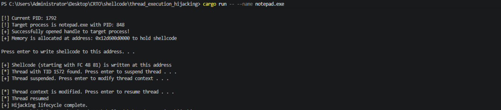
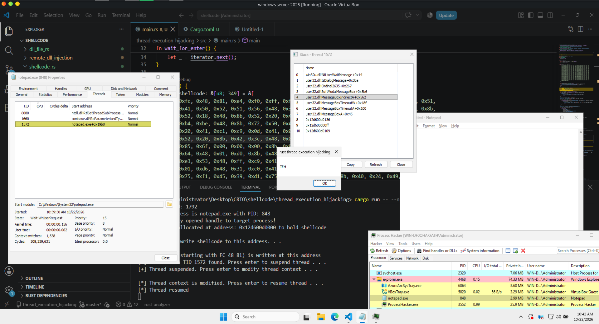
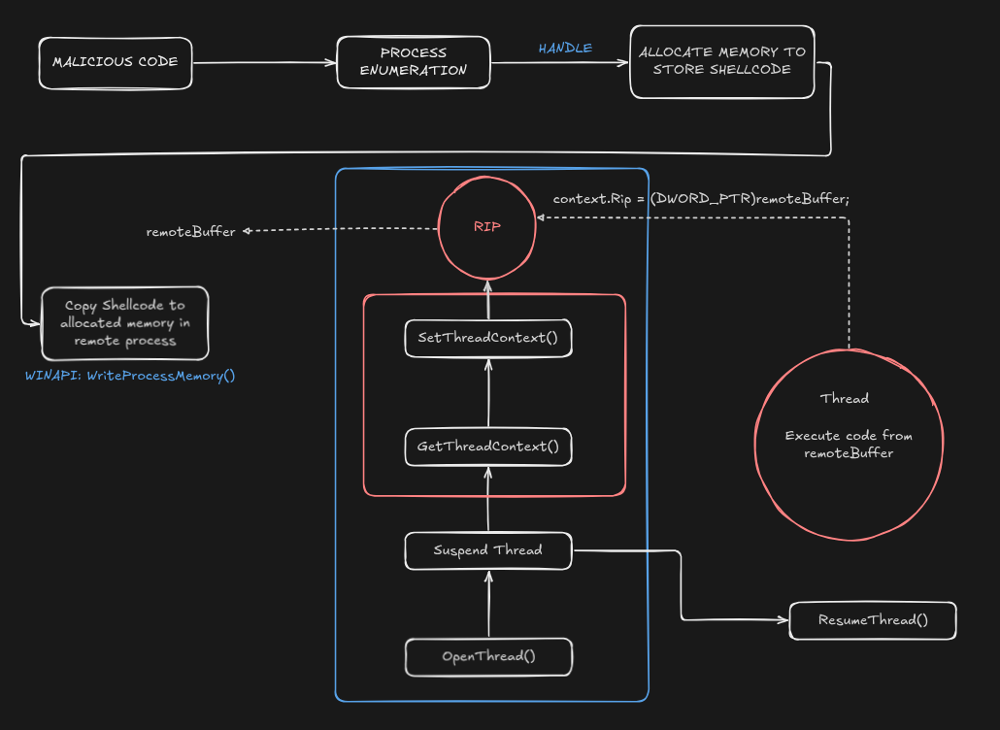

# Thread Execution Hijacking in Rust

> **CRTO lab notes · Windows x64 · MITRE ATT&CK [T1055.003](https://attack.mitre.org/techniques/T1055/003/)**
>
> A practical study of changing an existing thread's instruction pointer, understanding its execution context, and debugging a Notepad lab where the injector reported success but the process disappeared.

This chapter continues my Rust-based process-injection studies. In the [remote DLL injection exercise](../shellcode_dll_generation/docs/remote-dll-injection.md), the target executed a **newly created thread** that called into the Windows loader. Here, the important difference is that execution is redirected through a **thread that already exists** inside the target process.

The interesting part wasn't just reaching a MessageBox. On the first run, every API-stage log looked successful, but Notepad vanished from Process Hacker. Figuring out *why* was the main lesson of this experiment.

**Scope:** An authorized, lab-owned `notepad.exe` target; Rust on Windows x64; an intentionally visible MessageBox test payload. This is an educational case study, **not** a claim that the implementation safely restores arbitrary interrupted threads or works across all targets.

## At a glance

| Item | Lab detail |
| --- | --- |
| Technique | Thread Execution Hijacking — T1055.003 |
| Language | Rust, using Windows APIs through FFI bindings |
| Test application | `notepad.exe` (lab-owned) |
| Payload | x64 MessageBox test payload; reported size **349 bytes** in the later run |
| Initial result | API sequence completed; no MessageBox; target disappeared |
| Main finding | The earlier payload's **process-exit behavior** provides a strong explanation for the vanished process |
| Revised demonstration | `EXITFUNC=thread`; the later capture shows a MessageBox while Notepad remains visible |
| Important limitation | Terminating the selected thread is **not** the same as restoring its prior execution |

## Demo

The terminal capture records a complete run against Notepad: allocation, a write beginning FC 48 81, selection of TID 1572, thread suspension, a context update, and resumption.



The second capture supplies the stronger execution evidence. Notepad remains present in Process Hacker, the selected target thread is shown in a MessageBox-related stack, and the message box displays the lab text TEH under the title rust thread execution hijacking.



The screenshots show two different moments, with different PIDs and TIDs. Treat those numbers as lab observations, not configuration values: the target must be identified again each time it runs.

## 1. What is thread execution hijacking?

An ordinary Windows process contains one or more threads, each with an execution state. On x64, that state includes registers such as **RIP** (instruction pointer) and **RSP** (stack pointer).

In the technique studied here, a program retrieves a stopped thread's context, changes its saved instruction pointer, and asks Windows to apply the modified context. When the thread can run again, its instruction flow can follow that updated address.

Unlike the earlier remote-DLL example, this mechanism does **not inherently require a new remote thread**.

| Concept | Loader-based remote DLL example | Thread execution hijacking |
| --- | --- | --- |
| Execution vehicle | New remote thread | Existing target thread |
| Remote data | DLL path, interpreted by the loader | Machine-code bytes and related data |
| Execution entry | Loader routine as the thread start | Existing thread's updated instruction pointer |
| Main correctness concern | Loading and initialization | Interrupted state, entry, completion, and continuation |

### Conceptual lifecycle



The diagram is conceptual: successfully requesting each operation does not establish that the final execution outcome is correct.

## 2. Understanding the Windows pieces

### RIP, RSP, and CONTEXT

- **`RIP`** points to the instruction address from which an x64 thread is positioned to execute.
- **`RSP`** is the stack pointer. The stack already belongs to the thread's interrupted computation.
- **`CONTEXT`** is the architecture-specific Windows structure used to read or request changes to selected processor-state groups.
- **`ContextFlags`** controls which register groups are retrieved or applied. Merely having a field in the structure does not mean Windows populated it.

A line such as `context.Rip = remote_buffer as u64` changes a **local copy** of the register state. It does not change the target thread on its own. `SetThreadContext` and later execution are separate events.

**Important:** Changing RIP is not equivalent to a normal function call. It does not automatically create a return address, supply call arguments, preserve arbitrary live registers, or guarantee a safe path back to the original code.

### Process handle ≠ thread handle

The exercise uses separate Windows objects for separate responsibilities:

| API / concept | Role in the study |
| --- | --- |
| Process / thread enumeration | Identify the target PID and an existing TID |
| `OpenProcess` | Acquire a handle for process-level operations |
| `VirtualAllocEx`, `WriteProcessMemory` | Prepare the test bytes in the target address space |
| `OpenThread` | Acquire a handle to a specific existing thread |
| `SuspendThread` | Increment the thread's suspend count |
| `GetThreadContext` | Retrieve selected register state into local storage |
| `SetThreadContext` | Request a change to selected state of the stopped thread |
| `ResumeThread` | Decrement the suspend count; execution can resume when it reaches zero |

A snapshot's **first matching thread** is not necessarily the main thread or a safe place to interrupt. Likewise, `OpenProcess` opens a known process; it is not itself a process-enumeration API.

`ResumeThread` returns the **previous suspend count**, not a Boolean “payload executed” signal. For example, a return value of `1` means this call reduced the count to zero; a value greater than `1` means the thread remains suspended. Failure is reported as `0xFFFFFFFF`.

For more details, see the [CONTEXT structure](https://learn.microsoft.com/en-us/windows/win32/api/winnt/ns-winnt-context), [GetThreadContext](https://learn.microsoft.com/en-us/windows/win32/api/processthreadsapi/nf-processthreadsapi-getthreadcontext), [SetThreadContext](https://learn.microsoft.com/en-us/windows/win32/api/processthreadsapi/nf-processthreadsapi-setthreadcontext), and [ResumeThread](https://learn.microsoft.com/en-us/windows/win32/api/processthreadsapi/nf-processthreadsapi-resumethread) documentation.

## 3. The first run: all green logs, no payload effect

Here is the original unsuccessful run, preserved as recorded:

```text
[!] Current PID: 7680
[!] Target process is notepad.exe with PID: 7860
[+] Successfully opened handle to target process!
[+] Memory is allocated at address: 0x1b869810000 to hold shellcode

Press enter to write shellcode to this address. . .

[+] Shellcode (starting with FC 48 81) is written at this address
[*] Thread with TID 5636 found. Press enter to suspend thread . . .
[+] Thread suspended. Press enter to modify thread context . . .

[*] Thread context is modified. Press enter to resume thread . . .
[*] Thread resumed
[+] Hijacking lifecycle complete.
```

**Observed outcome:** No expected MessageBox appeared. Afterwards, Notepad and its threads were no longer visible in Process Hacker.

This distinction matters:

- **Observed:** The injector printed messages for successful preparation and context operations.
- **Observed:** The target subsequently disappeared from the process viewer.
- **Not established by those logs:** That the intended code ran, that no exception occurred, or that the process terminated for one specific reason.

The initial debugging question was therefore **not** “Why did `SetThreadContext` fail?” It was “What did the selected thread actually do *after* being resumed?”

### Hypotheses considered

| Hypothesis | Why it was considered | What the evidence says |
| --- | --- | --- |
| Stack / calling-convention problem | The interrupted thread did not enter the payload through an ordinary call frame | Worth examining, but no exception record in the shared log proves it caused this failure |
| Unsafe interruption point | The chosen thread might have been holding a lock or executing sensitive code | Possible in general; no recorded stack trace from the failed run proves it |
| Payload's exit behavior | A process-exiting payload would cause the entire Notepad process to disappear | Strongly supported by the payload family's source and the later change to a thread-exit variant |

## 4. Root-cause investigation: payload exit behavior

The strongest explanation in this study is the difference between terminating the **host process** and terminating only the **thread running the test payload**.

### Why `ExitProcess` mattered

Rapid7's [Metasploit x64 MessageBox implementation](https://github.com/rapid7/metasploit-framework/blob/master/modules/payloads/singles/windows/x64/messagebox.rb) defines a **default process-exit path** using `ExitProcess`. It has a distinct `EXITFUNC=thread` branch that uses a thread-exit strategy (`ExitThread` or `RtlExitUserThread`, depending on its own logic).

Windows documents that a process termination marks its remaining threads for termination. That matches the *kind* of observation made in Process Hacker when Notepad vanished.

The earlier payload was reported to end with:

```text
41 BA E4 1D F3 C7 FF D5
```

The x64 disassembly of that sequence is:

```asm
mov r10d, 0xC7F31DE4
call rbp
```

**Technical correction:** `FF D5` means **`call rbp`**, not `call r10`. In this Metasploit-style resolver, `R10D` carries a function hash while `RBP` is used as the resolver's call target. The immediate value only identifies a specific API **when interpreted using that resolver's hashing scheme**; its meaning cannot be inferred from the integer alone.

Taken together, the reported bytes, the upstream payload source, and the vanished process make a process-exit path the leading diagnosis. **The original log alone does not provide a debugger trace or exit code proving exactly which function executed.**

### Why the distinction changes the outcome

| Payload behavior | Effect on the hijacked thread | Effect on Notepad |
| --- | --- | --- |
| `ExitProcess` | Initiates process-wide termination | All threads are terminated as the process shuts down |
| `ExitThread` / `RtlExitUserThread` | Ends the currently executing thread | Other threads may continue, but losing a needed thread can still damage the application |
| Reaching an undefined continuation | Control flow is not reliably defined | May crash, hang, or behave unexpectedly |
| Preserving and resuming the original computation | Requires a separate, correct continuation design | **Not demonstrated** by the existing lab |

**Crucial lesson:** `EXITFUNC=thread` is *less destructive to the process as a whole* than process exit, but it is **not a general thread-restoration solution**. It deliberately ends the selected existing thread.

## 5. Revised lab payload and what it proved

For the later controlled MessageBox demonstration, the recorded payload generation command was:

```powershell
msfvenom -p windows/x64/messagebox TEXT="TEH" TITLE="rust thread execution hijacking" EXITFUNC=thread -f num
```

Reported tool output:

```text
[-] No platform was selected, choosing Msf::Module::Platform::Windows from the payload
[-] No arch selected, selecting arch: x64 from the payload
No encoder specified, outputting raw payload
Payload size: 349 bytes
Final size of num file: 2140 bytes
0xfc, 0x48, 0x81, ... 0xff, 0xd5
```

The raw byte array is intentionally omitted from the README; it belongs in the Rust source rather than duplicated as hundreds of hexadecimal literals in the documentation.

The later capture described in the original notes shows the test MessageBox with the title **`rust thread execution hijacking`** and body **`TEH`**, while Notepad remains present during the observation.

**What we can conclude:** The thread-redirection experiment reached the visible MessageBox path in that run, and the target was still present at the time of capture.

**What we cannot conclude:** That the original thread resumed its previous instruction stream, that all target resources remained usable, or that this behavior generalizes to every existing thread.

> **Note about `EXITFUNC=none`:** Do not assume that this option automatically creates a safe return path. In the referenced MessageBox module, the explicit special-case branch is for `THREAD`; other option handling should be checked against the exact module/version. A payload finishing without exiting does not automatically jump back to the original RIP.

## 6. Why stack alignment was not the established root cause

Windows x64 has a defined calling convention, including stack-alignment rules, shadow space, register preservation, and unwind behavior. Abrupt control-flow redirection can violate assumptions that hold during a normal call.

However, the reported MessageBox payload begins:

```asm
cld
and rsp, 0xfffffffffffffff0
```

That prologue **already aligns RSP downward**. It does not preserve the old RSP, make the original stack frame safe, or guarantee that the payload can return to the interrupted work.

An earlier suggestion to apply a generic `RSP` alignment adjustment before resumption was therefore **not supported as the fix for this case**. The actual payload's entry code must be considered before making claims about alignment, and an access violation should be established from debugger evidence rather than assumed.

Likewise, taking an original RIP snapshot is not enough to achieve restoration. The interrupted computation can depend on flags, general-purpose registers, SIMD state, stack contents, and in-flight operating-system or application invariants.

Reference: [Microsoft x64 calling convention](https://learn.microsoft.com/en-us/cpp/build/x64-calling-convention).

## 7. Rust implementation notes

The original README describes a study implementation under [`src/main.rs`](src/main.rs). It uses process and thread enumeration, remote memory preparation, and the Windows thread-context API family. The live Rust source itself was **not attached with this README revision**, so the notes below describe the reported implementation rather than an independently audited build.

Key points worth keeping in mind when reading the code:

1. **Use architecture-correct bindings.** Windows x64 `CONTEXT` has architecture-specific layout and alignment requirements; an arbitrary hand-written Rust struct is not an interchangeable substitute.
2. **Separate local values from remote addresses.** A target address represented as a Rust integer or pointer is not local process memory you can safely dereference.
3. **Inspect API return contracts.** Some calls return a count or sentinel rather than a plain success flag. Record `GetLastError` when the particular API contract makes it relevant.
4. **Treat thread IDs as observations.** The first matching snapshot entry is not necessarily a main thread, and snapshot information can become stale.
5. **Keep evidence precise.** “Remote write accepted,” “context update accepted,” “thread resumed,” and “MessageBox observed” are four different findings.
6. **Do not conflate handle cleanup with execution cleanup.** Closing handles does not undo a context change or guarantee the target has stopped using remote memory.

### An easily missed synchronization detail

The original notes report `WaitForSingleObject(thread1, INFINITE)`. Waiting on a **thread handle** normally waits for the thread to **terminate**. For a thread-exit demonstration that may be meaningful, but it is **not** a generic “wait until the injected work finishes” primitive for a long-lived application thread.

A log such as `Hijacking lifecycle complete` should therefore be read as the injector reaching the end of its own recorded path, not as proof of safe execution and restoration.

## 8. Debugging and evidence checklist

For future lab notes, capture one observation per boundary, and separate the facts from the interpretation.

| Check | What it helps establish |
| --- | --- |
| Target PID and chosen TID | Which instance and thread were involved |
| Allocation address, size, and protection | Where the test bytes were prepared |
| Bytes written / return status | Whether the requested write was accepted |
| Context operation return codes | Whether Windows accepted each context request |
| Thread suspend count before/after resume | Whether the thread could become runnable |
| Original and requested instruction addresses | Whether the intended addresses differ |
| Debugger exception code or target exit code, when available | Whether disappearance reflects a fault or termination |
| Visible MessageBox and target lifetime | Whether the demo behavior was observed and the process was still present |
| Thread state after payload completion | Whether the original application thread survived or terminated |

Suggested lab log vocabulary:

```text
[+] Remote buffer allocated
[+] Test bytes written
[+] Context update accepted
[+] Resume request accepted
[*] Waiting for independent execution evidence...
[+] MessageBox observed in the lab capture
[!] Original-thread continuation not established
```

This avoids declaring “shellcode executed” immediately after a successful `ResumeThread` call.

## 9. Detection and defensive visibility

Reusing an existing thread changes which telemetry might appear, **not** whether the activity is observable.

Defensive investigations can correlate unusual cross-process access, memory permissions and writes, thread-context changes, and execution at private or otherwise unexpected memory regions. These signals need context: debuggers and legitimate instrumentation also inspect or modify thread state.

Two common logging mistakes to avoid:

- **Sysmon Event ID 8** reports creation of a remote thread. This technique reuses an existing thread, so Event 8 is not a guaranteed signal of the hijack itself.
- **Sysmon Event ID 10** can record process-access activity when configured, but it does not by itself prove that a remote write or RIP update occurred.

Use available endpoint telemetry and debugger observations together rather than treating the absence of one event as proof of invisibility.

References: [MITRE ATT&CK T1055.003](https://attack.mitre.org/techniques/T1055/003/) and [Microsoft Sysmon](https://learn.microsoft.com/en-us/sysinternals/downloads/sysmon).

## 10. Key takeaways

1. **API success is not payload success.** Allocation, writing, and setting thread context can succeed without the intended visible result.
2. **Payload exit semantics matter.** `ExitProcess` affects the entire host, while `ExitThread` ends the current thread; neither is an automatic return to interrupted work.
3. **A thread has pre-existing state.** RIP, RSP, registers, flags, stack frames, and application invariants deserve more attention than the single instruction-pointer assignment.
4. **The debugging story matters more than a green console.** In this lab, the disappearing Notepad process was the observation that led to examining the payload's own termination path.
5. **Document proof and limitations separately.** The later MessageBox validates a visible demonstration, not universal stability or successful execution restoration.

## Repository navigation

- [Rust study implementation](src/main.rs)
- [Cargo manifest](Cargo.toml)
- [Previous remote DLL injection study](../shellcode_dll_generation/docs/remote-dll-injection.md)
- [Shellcode / DLL generation foundations](../shellcode_dll_generation/README.md)

## References

- [MITRE ATT&CK — Thread Execution Hijacking (T1055.003)](https://attack.mitre.org/techniques/T1055/003/)
- [Microsoft — CONTEXT structure (x64)](https://learn.microsoft.com/en-us/windows/win32/api/winnt/ns-winnt-context)
- [Microsoft — GetThreadContext](https://learn.microsoft.com/en-us/windows/win32/api/processthreadsapi/nf-processthreadsapi-getthreadcontext)
- [Microsoft — SetThreadContext](https://learn.microsoft.com/en-us/windows/win32/api/processthreadsapi/nf-processthreadsapi-setthreadcontext)
- [Microsoft — SuspendThread](https://learn.microsoft.com/en-us/windows/win32/api/processthreadsapi/nf-processthreadsapi-suspendthread) / [ResumeThread](https://learn.microsoft.com/en-us/windows/win32/api/processthreadsapi/nf-processthreadsapi-resumethread)
- [Microsoft — x64 calling convention](https://learn.microsoft.com/en-us/cpp/build/x64-calling-convention)
- [Microsoft — Terminating a process](https://learn.microsoft.com/en-us/windows/win32/procthread/terminating-a-process)
- [Microsoft — WaitForSingleObject](https://learn.microsoft.com/en-us/windows/win32/api/synchapi/nf-synchapi-waitforsingleobject)
- [Rapid7 Metasploit — x64 MessageBox payload source](https://github.com/rapid7/metasploit-framework/blob/master/modules/payloads/singles/windows/x64/messagebox.rb)
- [Microsoft — Sysmon](https://learn.microsoft.com/en-us/sysinternals/downloads/sysmon)

---
